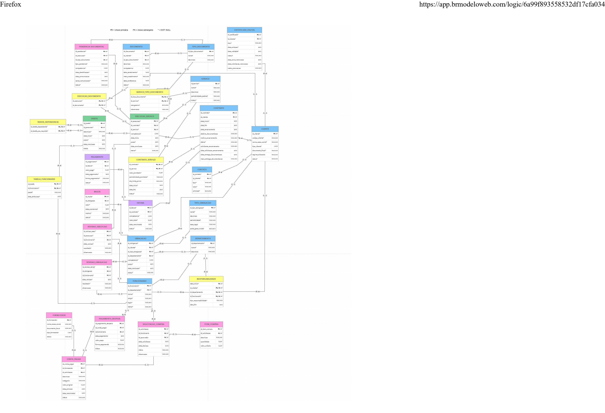
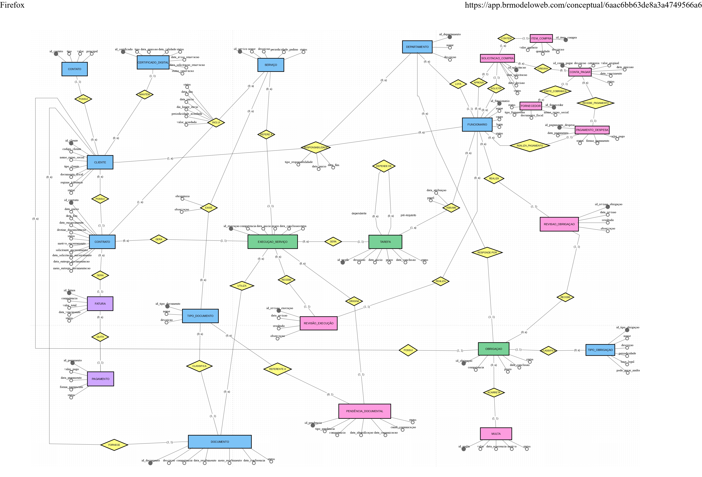

# Entrega 2 — Modelo Lógico, Implementação SQL e Apresentação Final
### Sistema de Gestão de Informações — DML CONTABILIDADE LTDA.

> **Projeto acadêmico; dados de teste integralmente fictícios.** Este README documenta o esquema relacional implementado e a investigação realizada com a organização. O projeto é um **banco de dados com consultas**, não um software já implantado no escritório. A existência de campos ou consultas não implica envio automático de alertas, controle de permissões, trilhas automáticas de auditoria nem integração com o ERP.

## 1. Relatório Técnico Final

### Integrantes
| Nome completo | RGM | Usuário do GitHub |
|---|---|---|
| Vinícius Dias Gomes | 47441081 | [Vinicius-941](https://github.com/Vinicius-941) |
| Guilherme de Souza Lopes dos Santos | 47475609 | [GLope-ui](https://github.com/GLope-ui) |
| Valquíria Rodrigues de Macedo | 47415061 | [ValRodMac2808](https://github.com/ValRodMac2808) |
| Gabrielly Witai Pereira | 47396750 | [Gabwitai](https://github.com/Gabwitai) |
| Pablo Henrique Lourenço Guimarães | 47672285 | [PabloHenrique2008](https://github.com/PabloHenrique2008) |

### 1.1 Revisão do Modelo Conceitual

#### Caracterização e escopo
A **DML CONTABILIDADE LTDA.** é uma empresa privada de serviços contábeis, fiscais, societários e de apoio a rotinas trabalhistas. Seu [site institucional](https://www.dmlcontabilidade.com.br/) informa atuação desde 1976. O escritório está situado na **Av. Guapira, 539, Tucuruvi, São Paulo/SP, CEP 02265-001**, e mantém **uma unidade**, com cerca de **7 funcionários** e **100 clientes ativos**, entre pessoas físicas e jurídicas, segundo o levantamento de campo. O contato institucional divulgado é **(11) 98857-6266**, também informado para o responsável pela organização, **Deni Maricato Maciel**, proprietário/sócio-diretor.

A organização foi escolhida pela possibilidade de acesso ao responsável e por possuir rotinas integradas de atendimento, faturamento, documentação, prazos e compras adequadas a um projeto relacional. **Não há vínculo familiar ou trabalhista entre os integrantes do grupo e a DML**. A existência da organização pode ser conferida pelo endereço e pelo site, complementados pela evidência da videochamada disponível neste repositório. Utiliza o ERP contábil Alterdata; documentos podem chegar por captura vinculada a certificado digital A1, e-mail, WhatsApp corporativo e entrega física. Planilhas Excel e documentos Word complementam os controles de faturamento, conferência e contratos.

**Problemas informacionais observados/relatados:**

- **P01:** Ausência de registro formal e padronizado do recebimento e da conferência de cada documento.
- **P02:** Acompanhamento de tarefas disperso entre departamentos, sem visão única de pendências, andamento e atrasos.
- **P03:** Prazos de obrigações controlados de modo descentralizado, sem mecanismo sistematizado de consulta de vencimentos iminentes.
- **P04:** Informações do cliente ausentes, tardias ou incorretas geram pendências e retrabalho, sobretudo na folha de pagamento.
- **P05:** Conferência de faturamento e cobrança apoiada em controles paralelos, dificultando visão consolidada de valores emitidos e recebidos.

A organização **não** relatou dificuldade geral para localizar arquivos: o ERP e o servidor já concentram informações. Esse aspecto não foi classificado como problema no escopo do projeto. O escopo contempla clientes, equipe, contratos, serviços, documentos, tarefas, revisões, obrigações, multas, faturamento e pagamentos, além de compras, fornecedores, contas a pagar, encerramento contratual e renovação de certificados. **Compras e certificados são processos complementares mapeados**, não problemas adicionais presumidos.

#### Levantamento de campo e atualização após a Entrega 1
O levantamento foi realizado em **três etapas**: **03/09/2026 (presencial)**, **15/09/2026 (videochamada)** e **26/10/2026 (mensagens)**. A primeira etapa iniciou o roteiro, que foi completado na segunda; a terceira incluiu **18 perguntas complementares** sobre compras, contas a pagar, encerramento de contrato, certificado digital, distribuição de funcionários, inadimplência e proteção de dados. **Somente Valquíria Rodrigues de Macedo participou das entrevistas pelo grupo; Deni Maricato Maciel, proprietário, respondeu a todas.** O encontro de 03/09 ocorreu presencialmente no escritório da Av. Guapira, 539. A continuidade de 15/09 ocorreu integralmente por videochamada, e o levantamento complementar de 26/10 foi respondido por mensagens/áudios. O grupo não possui registro escrito de achados de observação presencial independentes das declarações do entrevistado; portanto, descrições das rotinas abaixo são atribuídas às respostas de Deni, sem apresentar observações não documentadas como fatos presenciados. As respostas descritas abaixo são provenientes desse levantamento, enquanto os controles propostos são decisões de projeto, não funcionalidades já implantadas.

- **Compras e despesas:** são adquiridos materiais de escritório, água, café, higiene, licenças e serviços necessários. Um funcionário solicita; o proprietário decide sobre a autorização, e o próprio proprietário realiza os pagamentos. Uma solicitação pode ter vários itens. Despesas podem estar relacionadas a uma solicitação ou ser registradas diretamente, como contas periódicas.
- **Encerramento de contrato:** pode ser solicitado pelo cliente por e-mail ou iniciado pelo escritório em situações como descumprimento contratual, inadimplência ou riscos à responsabilidade profissional. A documentação é encaminhada por e-mail, motofrete ou retirada, com registro de destino.
- **Certificados digitais:** a validade é acompanhada em planilha; o escritório avisa o cliente aproximadamente um mês antes do vencimento e uma certificadora parceira conduz o processo de renovação. O banco registra validade, aviso, solicitação e estado da renovação, mas **não realiza a renovação**.
- **Equipe:** as pessoas são distribuídas por departamento conforme especialidade; substituições são possíveis. A alocação é representada por lotação e responsabilidade sobre clientes.
- **Cobrança:** vencimentos podem ocorrer nos dias 5, 10, 15 ou 30, conforme acerto com o cliente. Foram relatadas multa contratual de 2% e taxa de juros de 0,3% ao dia em atraso. Esses percentuais são **relato da entrevista**, não validação jurídica nem prova de que o script aplica o encargo automaticamente.
- **Dados pessoais:** a empresa relatou cláusulas contratuais, acessos restritos e proteção por senhas. O modelo não implementa sozinho autenticação, autorização de acesso ou um programa completo de adequação à LGPD.

**Evidências do levantamento:** a divulgação da captura da videochamada foi autorizada pelos participantes, conforme informação do grupo. A captura da videochamada de 15/09/2026 está disponível em [`docs/evidencias/entrevista_videochamada_15-09-2026.png`](docs/evidencias/entrevista_videochamada_15-09-2026.png). As respostas da entrevista de 26/10/2026 foram obtidas por mensagens de áudio, cujos arquivos não integram o repositório público. Conforme orientação relatada pelo grupo, a ausência de fotografia da entrevista presencial foi discutida previamente com o professor. A metodologia e as evidências estão descritas em [`levantamento/levantamento.md`](levantamento/levantamento.md).

**Revisões no DER e no modelo:**
| Situação identificada | Revisão adotada | Justificativa |
|---|---|---|
| Rotinas de compras e contas a pagar não estavam representadas | Inclusão de `fornecedor`, `solicitacao_compra`, `item_compra`, `conta_pagar`, `pagamento_despesa` | Representar autorização, itens, cobrança de fornecedor e quitação |
| Encerramento de contrato sem todos os elementos de rastreio | Inclusão de motivo, solicitante, data da solicitação, data e meio de entrega | Documentar decisão e destino da documentação |
| Controle de certificado limitado à emissão/validade | Inclusão de data do aviso, data da solicitação e estado de renovação | Acompanhar a comunicação e a renovação |
| Processo de compras exigia dois papéis sobre a mesma pessoa | Duas FKs da solicitação para funcionário, solicitante e aprovador | Preservar o papel desempenhado em cada operação |
| Regras de vínculo entre serviços e documentos | Tabelas associativas para relacionamentos N:N | Evitar listas multivaloradas e registrar atributos dos vínculos |

**Tratamento dos apontamentos recebidos na avaliação da Entrega 1:**

| Apontamento da avaliação | Correção na Entrega 2 | Evidência no projeto |
|---|---|---|
| Caracterização sem endereço e comprovação externa suficientes | Inclusão do endereço completo, site e contato institucional; evidência da videochamada ligada no texto | Seção 1.1 e `docs/evidencias/` |
| Texto descrevia apenas entrevista presencial, mas foto era de videochamada | Datas e meios das três etapas diferenciados | Seção 1.1 e `levantamento/levantamento.md` |
| Entrevista original não anexada como levantamento organizado | Documento de síntese do levantamento separado do README; preservação do roteiro bruto como fonte, quando anexado | `levantamento/levantamento.md` |
| Processo de compras/despesas não descrito | Inclusão de solicitação, aprovação, itens, fornecedores, contas e pagamentos | Processo 7, RF14–RF17, RN17–RN20 e cinco tabelas novas |
| Encerramento contratual só aparecia em regra | Processo completo de solicitação e entrega de documentação, com datas, solicitante e meio | Processo 2, RF04/RF18 e `contrato` |
| Controle e renovação de certificados só apareciam em requisitos | Processo de acompanhamento de validade, aviso e renovação por parceiro | Processo 8, RF03 e `certificado_digital` |
| Gestão de pessoal com descrição parcial | Lotação por departamento, responsabilidade por cliente e possibilidade de substituição | Processo 1 e processo 9; `funcionario` e `responsabilidade` |
| Política de inadimplência não estava explicitada | Registro de vencimento, saldo e percentuais contratuais informados, com separação entre consulta e cobrança automática | Processo 6 e seção 1.5 |
| Limites de segurança e LGPD precisam ser explicitados | Distinção entre cláusulas/medidas relatadas e controles não implementados pelo SQL | RNF02/RNF07 e seção 1.5 |

A correção da Entrega 1 reconheceu a adequação do DER original, do dicionário e dos requisitos principais. A revisão preservou essa base e estendeu os processos cuja cobertura havia sido considerada parcial ou ausente.
#### Processos de negócio

Os processos de negócio apresentados nesta seção representam as principais atividades operacionais e administrativas da DML CONTABILIDADE LTDA., organizadas em uma sequência lógica para facilitar sua compreensão. A numeração de 1 a 9 identifica essas atividades, enquanto os códigos **P01 a P05**, apresentados na caracterização da organização, identificam especificamente os problemas encontrados durante o levantamento de requisitos. Esses problemas estão associados aos processos descritos abaixo e possuem rastreabilidade com as tabelas do banco de dados e as consultas gerenciais, conforme demonstrado na Seção 1.6. Dessa forma, a numeração dos processos e a codificação dos problemas possuem finalidades distintas, evitando ambiguidades na documentação.

1. **Cadastro, canais e responsável:** cadastro de cliente PF/PJ com código interno e documento fiscal; canais de contato por cliente e atribuição de funcionários/departamentos.
2. **Contratação e encerramento:** contrato com situação e datas; serviços contratados com valores/periodicidades próprios; registro de solicitação e conclusão de encerramento, destino e entrega da documentação.
3. **Documentos:** registro de tipo, competência, canal e conferência. A ausência/incorreção gera pendência ligada à execução.
4. **Execução e revisão:** execução do serviço contratado por competência, geração de tarefas com responsáveis e dependências e revisão antes de concluir.
5. **Obrigações:** associação a cliente, tipo, competência, departamento, prazo, conferência e eventual multa.
6. **Faturamento:** emissão de fatura por contrato e competência, registro de pagamentos e cálculo de valores recebidos/em aberto.
7. **Compras e despesas:** solicitação por funcionário, decisão do proprietário, itens da compra, fornecedor, conta a pagar, pagamento e agente responsável.
8. **Certificados digitais:** acompanhamento de emissão e validade, identificação de certificados próximos de vencer, aviso ao cliente aproximadamente 30 dias antes do término, solicitação de renovação e acompanhamento do estado até a atuação da certificadora parceira. O aviso e a renovação são atividades organizacionais; o SQL permite consultá-las, não as executa automaticamente.
9. **Equipe e responsabilidades:** contratação e lotação de funcionário em departamento conforme especialidade, atribuição de responsáveis por cliente e período e substituição quando necessário. O modelo registra lotação e vigência, sem motor de escalas ou folha de pagamento dos próprios funcionários.

**Inadimplência no faturamento:** a emissão de boleto segue o vencimento pactuado (dias 5, 10, 15 ou 30). Pagamentos confirmados reduzem o saldo em aberto; para pagamentos em atraso, foram relatados multa contratual de 2% e juros de 0,3% ao dia. Esses valores são tratados como informação declarada na etapa mais recente do levantamento, não como regra jurídica universal nem funcionalidade automática implementada. Um registro antigo no repositório menciona 0,33% ao dia; a divergência não altera o modelo e deve ser confirmada com o responsável antes de eventual cálculo efetivo de encargos.

#### Requisitos funcionais
- **RF01:** Registrar cliente com código interno, nome/razão social, tipo PF/PJ, documento fiscal, regime tributário aplicável e situação.
- **RF02:** Registrar múltiplos contatos e canal preferencial de cada cliente.
- **RF03:** Registrar certificado digital por cliente, tipo, datas de emissão/validade, situação, aviso e solicitação de renovação.
- **RF04:** Registrar contrato com datas, situação, encerramento e destino documental, além dos serviços e respectivas condições negociadas.
- **RF05:** Registrar execuções de serviço por contrato, serviço, competência, prazos, situação e conclusão.
- **RF06:** Registrar tarefas, responsáveis, papéis, atribuições e dependências entre tarefas.
- **RF07:** Registrar documentos por cliente, tipo, competência, recebimento, situação e conferência.
- **RF08:** Registrar pendências documentais por execução, tipo, competência, datas, comunicação e situação.
- **RF09:** Registrar obrigações por cliente, tipo, departamento, competência, prazo e situação.
- **RF10:** Registrar multa com obrigação relacionada, motivo, data e valor.
- **RF11:** Registrar revisão por funcionário, data e resultado, tanto para execuções quanto para obrigações.
- **RF12:** Registrar faturas por contrato e competência, respectivos vencimentos e pagamentos confirmados.
- **RF13:** Consultar documentos, tarefas, obrigações e valores pendentes por competência, prazo, cliente e departamento.
- **RF14:** Registrar fornecedor PF/PJ com documento fiscal, tipo e situação.
- **RF15:** Registrar solicitação de compra com funcionário solicitante, aprovador opcional, datas, decisão e itens (descrição, quantidade e valor unitário).
- **RF16:** Registrar contas a pagar vinculadas a fornecedor e opcionalmente à solicitação, com categoria, valor, emissão, vencimento e situação.
- **RF17:** Registrar pagamentos de despesas com conta, funcionário, data, valor, meio e situação.
- **RF18:** Registrar motivo, solicitante, solicitação de encerramento, data/meio de entrega documental e estado da renovação dos certificados.

#### Requisitos não funcionais e limites de implementação
- **RNF01:** Integridade referencial com PK/FK e `ON DELETE RESTRICT`, implementada nas tabelas.
- **RNF02:** Acesso de acordo com função/setor: **requisito de aplicação**, não implementado por autenticação neste SQL.
- **RNF03:** Rastreabilidade de autoria: o esquema registra agentes em tarefas, revisões, compras e pagamentos, mas **não registra automaticamente toda alteração de dados**.
- **RNF04:** Preservar histórico por estados e datas de encerramento, embora o banco isolado não impeça todos os comandos de exclusão por usuários privilegiados.
- **RNF05:** Suporte a consultas por chaves, competências e prazos; o desempenho em escala real exige medição.
- **RNF06:** Backup e disponibilidade dependem de infraestrutura e operação, fora do escopo do script.
- **RNF07:** Minimização e proteção de dados pessoais requerem controles administrativos e técnicos adicionais.
- **RNF08:** Usabilidade depende de interface futura; não demonstrada pelo banco relacional.

#### Regras de negócio
- **RN01:** Cliente deve existir antes da execução de serviços; vínculos são garantidos por FKs.
- **RN02:** Cada cliente possui código interno único (`UNIQUE`).
- **RN03:** Cadastro de clientes é atribuição administrativa; autorização depende da aplicação.
- **RN04:** Um cliente pode contratar vários serviços, com preço e periodicidade acordados por contrato.
- **RN05:** Clientes devem possuir responsáveis; presença é conferida por A02, não por restrição universal na DDL.
- **RN06:** Cada funcionário tem lotação em um departamento; responsabilidade deve ser coerente com lotação.
- **RN07:** Toda tarefa deve ter funcionário designado; verificação A03.
- **RN08:** Tarefa dependente só inicia após conclusão dos pré-requisitos; verificação A04.
- **RN09:** Execução e obrigação exigem revisão aprovada antes de conclusão; verificações A05 e A06.
- **RN10:** Serviço pode exigir documentos; vínculo e pertinência da documentação são verificados.
- **RN11:** Documento ausente/incorreto pode gerar pendência e comunicação ao cliente.
- **RN12:** Prazo de obrigação depende da legislação/regime e pode variar por cliente.
- **RN13:** Descumprimento de obrigação pode gerar multa.
- **RN14:** Fatura é emitida por contrato e sua quitação ocorre via boleto; verificação A07.
- **RN15:** Atraso é determinado por prazo anterior à referência e ausência de conclusão.
- **RN16:** No encerramento, registrar destino da documentação; verificação A08.
- **RN17:** Solicitação de compra aprovada ou rejeitada registra aprovador e data da decisão; A13.
- **RN18:** Aprovação de compras cabe ao proprietário/diretor; A16 verifica o cargo na base de teste.
- **RN19:** Conta a pagar associada a uma solicitação deve derivar de solicitação aprovada; A14.
- **RN20:** Contas pagas devem ser conciliadas com os pagamentos confirmados; A15.
- **RN21:** Certificados devem permitir acompanhar aviso, solicitação e situação da renovação.
- **RN22:** Desligamento de contrato registra solicitante, motivo, entrega e meio, quando conhecidos.

**Aplicação versus banco:** as auditorias Axx identificam violações na amostra, porém não substituem regras transacionais nem autorização para impedir toda violação futura. Regras adicionais RN17–RN22 representam formalização de processos do levantamento complementar.

### 1.2 Conversão do Modelo Conceitual para o Modelo Lógico

A conversão para o modelo relacional originou **30 tabelas**: 25 correspondentes ao núcleo original e cinco referentes a compras/contas a pagar. Entidades conceituais como `CLIENTE`, `CONTRATO` e `OBRIGACAO` foram convertidas em tabelas; atributos simples tornaram-se colunas com tipos (`VARCHAR`, `DATE`, `INT`, `DECIMAL`), nulidade e restrições. Campos multivalorados foram separados em entidades, por exemplo os vários contatos de um cliente.

Em relacionamentos **1:N**, a FK está do lado N (ex.: `contrato.id_cliente` → `cliente.id_cliente`; `item_compra.id_solicitacao` → `solicitacao_compra.id_solicitacao`). Em **N:N**, foi criada tabela associativa, incluindo `contrato_servico`, `servico_tipo_documento`, `execucao_documento`, `tarefa_funcionario` e `tarefa_dependencia`. A associação ternária de cliente, funcionário e departamento foi materializada em `responsabilidade`, com dados de vigência. Relações recursivas de dependência de tarefas são representadas por duas FKs para `tarefa`. Não há herança/generalização formal no DER; PF/PJ são diferenciadas por atributo de tipo em `cliente` e `fornecedor`.

Os novos processos resultaram em `solicitacao_compra` com duas FKs para `funcionario` (quem solicita e quem aprova), `item_compra` para os itens, `conta_pagar` ligada a `fornecedor` e opcionalmente à compra, e `pagamento_despesa` para pagamentos e seu executor. Relação 1:1 não foi criada artificialmente onde o levantamento não a confirmou; campos opcionais representam participações de cardinalidade mínima zero.

### 1.3 Definição de Chaves Primárias e Estrangeiras

A tabela a seguir foi gerada a partir das declarações `CREATE TABLE` do script final. Identificadores substitutos inteiros facilitam referências; unicidade de negócios é protegida separadamente por `UNIQUE` quando pertinente.
| Tabela | Chave primária | Chaves estrangeiras (coluna → tabela.coluna) |
|---|---|---|
| `departamento` | `id_departamento` | Nenhuma |
| `cliente` | `id_cliente` | Nenhuma |
| `servico` | `id_servico` | Nenhuma |
| `tipo_documento` | `id_tipo_documento` | Nenhuma |
| `tipo_obrigacao` | `id_tipo_obrigacao` | Nenhuma |
| `funcionario` | `id_funcionario` | `id_departamento` → `departamento.id_departamento` |
| `contato` | `id_contato` | `id_cliente` → `cliente.id_cliente` |
| `certificado_digital` | `id_certificado` | `id_cliente` → `cliente.id_cliente` |
| `contrato` | `id_contrato` | `id_cliente` → `cliente.id_cliente` |
| `fatura` | `id_fatura` | `id_contrato` → `contrato.id_contrato` |
| `pagamento` | `id_pagamento` | `id_fatura` → `fatura.id_fatura` |
| `documento` | `id_documento` | `id_cliente` → `cliente.id_cliente`; `id_tipo_documento` → `tipo_documento.id_tipo_documento` |
| `execucao_servico` | `id_execucao` | `id_contrato` → `contrato.id_contrato`; `id_servico` → `servico.id_servico` |
| `tarefa` | `id_tarefa` | `id_execucao` → `execucao_servico.id_execucao` |
| `revisao_execucao` | `id_revisao_exec` | `id_execucao` → `execucao_servico.id_execucao`; `id_funcionario` → `funcionario.id_funcionario` |
| `pendencia_documental` | `id_pendencia` | `id_execucao` → `execucao_servico.id_execucao`; `id_tipo_documento` → `tipo_documento.id_tipo_documento` |
| `obrigacao` | `id_obrigacao` | `id_cliente` → `cliente.id_cliente`; `id_tipo_obrigacao` → `tipo_obrigacao.id_tipo_obrigacao`; `id_departamento` → `departamento.id_departamento` |
| `revisao_obrigacao` | `id_revisao_obrig` | `id_obrigacao` → `obrigacao.id_obrigacao`; `id_funcionario` → `funcionario.id_funcionario` |
| `multa` | `id_multa` | `id_obrigacao` → `obrigacao.id_obrigacao` |
| `contrato_servico` | `id_contrato, id_servico` | `id_contrato` → `contrato.id_contrato`; `id_servico` → `servico.id_servico` |
| `servico_tipo_documento` | `id_servico, id_tipo_documento` | `id_servico` → `servico.id_servico`; `id_tipo_documento` → `tipo_documento.id_tipo_documento` |
| `execucao_documento` | `id_execucao, id_documento` | `id_execucao` → `execucao_servico.id_execucao`; `id_documento` → `documento.id_documento` |
| `tarefa_funcionario` | `id_tarefa, id_funcionario` | `id_tarefa` → `tarefa.id_tarefa`; `id_funcionario` → `funcionario.id_funcionario` |
| `tarefa_dependencia` | `id_tarefa_dependente, id_tarefa_pre_requisito` | `id_tarefa_dependente` → `tarefa.id_tarefa`; `id_tarefa_pre_requisito` → `tarefa.id_tarefa` |
| `responsabilidade` | `id_cliente, id_departamento, id_funcionario, data_inicio` | `id_cliente` → `cliente.id_cliente`; `id_departamento` → `departamento.id_departamento`; `id_funcionario` → `funcionario.id_funcionario` |
| `fornecedor` | `id_fornecedor` | Nenhuma |
| `solicitacao_compra` | `id_solicitacao` | `id_funcionario` → `funcionario.id_funcionario`; `id_aprovador` → `funcionario.id_funcionario` |
| `item_compra` | `id_item_compra` | `id_solicitacao` → `solicitacao_compra.id_solicitacao` |
| `conta_pagar` | `id_conta_pagar` | `id_fornecedor` → `fornecedor.id_fornecedor`; `id_solicitacao` → `solicitacao_compra.id_solicitacao` |
| `pagamento_despesa` | `id_pagamento_despesa` | `id_conta_pagar` → `conta_pagar.id_conta_pagar`; `id_funcionario` → `funcionario.id_funcionario` |

### 1.4 Normalização até a 3ª Forma Normal

**1FN:** cada célula contém valor atômico. Não são guardadas listas de serviços em `contrato`, de funcionários em `tarefa` ou de itens em `solicitacao_compra`: cada relação recebe sua própria linha em tabela associativa ou dependente. Os meios de contato de cliente ficam em `contato`, e não em várias colunas repetitivas.

**2FN:** atributos descritivos dependem da chave completa de sua relação. Nas associações, o valor negociado e a periodicidade do serviço são propriedades do **par contrato–serviço**, e não apenas de `servico`. No detalhamento de compras, `quantidade` e `valor_unitario` descrevem o item, que tem identificador próprio; os atributos da solicitação permanecem na tabela pai. Nas demais tabelas com PK simples, não existem dependências parciais de uma PK composta.

**3FN:** características de cliente, fornecedor, departamento, funcionário, tipo documental e tipo de obrigação são armazenadas nas respectivas tabelas de referência, sem duplicá-las sistematicamente nas transações. Ex.: `conta_pagar` guarda `id_fornecedor`, não repete nome/documento fiscal; `funcionario` guarda `id_departamento` e não o nome do setor; `fatura` remete a `contrato` em vez de copiar seus dados cadastrais. Isso reduz anomalias de atualização e favorece consistência histórica.

**Limite da afirmação:** esta é a justificativa da decomposição adotada com base nas dependências identificadas; uma prova formal de 3FN requer levantamento completo de dependências funcionais de cada relação. O uso de identificadores artificiais isoladamente não comprova 3FN.

### 1.5 Justificativas Técnicas

- **PKs:** identificadores numéricos em entidades principais e chaves compostas nas relações associativas, evitando depender de nomes, CPF/CNPJ ou datas mutáveis para identificar entidades. Os critérios de unicidade de cada tabela são explicitados no dicionário de dados e no DDL.
- **FKs:** implementam correspondências entre clientes, contratos, serviços, funcionários, documentos, compras e pagamentos; `RESTRICT` dificulta excluir pais com dependentes.
- **Obrigatoriedade e domínios:** `NOT NULL` para atributos essenciais e `CHECK` para situação, tipo, valores positivos, datas coerentes e validações de formato. Exemplos: `ck_cliente_tipo`, `ck_certificado_datas`, `ck_sol_compra_decisao`, `ck_item_compra_quantidade` e `ck_conta_pagar_datas`. Os `CHECK` requerem **MySQL 8.0.16+**.
- **Unicidade:** código de cliente e identificador fiscal têm índices de unicidade; outras unicidades são especificadas explicitamente no DDL.
- **Valores monetários:** `DECIMAL` evita aproximações de ponto flutuante para os valores financeiros; o brModelo pode exibir tipos genéricos, mas o SQL executável define os tipos implementados.
- **Nulidade intencional:** `id_aprovador`, `data_decisao` e `id_solicitacao` em conta a pagar admitem ausência quando o evento/processo correspondente não ocorreu.
- **Histórico:** situação e datas de encerramento mantêm trilha de negócio, embora não haja `LOG_ALTERACAO` automático para registrar mudanças feitas diretamente no banco.
- **Segurança:** a coluna de login do funcionário não equivale a sistema de perfis, controle de permissões ou conformidade completa com a LGPD.
- **Multas e juros:** os percentuais citados na entrevista não devem ser apresentados como calculados automaticamente pelo banco sem consulta ou rotina específica.

### 1.6 Proposta de Arquitetura Analítica para BI e IA

Os indicadores abaixo são **propostos pelo grupo**, baseados em dados efetivamente armazenados. Datas fixas de 2026 nos exemplos SQL permitem reprodutibilidade; em implantação real deveriam ser parametrizadas. Metas apresentadas são referenciais para discussão com a organização, **não metas confirmadas na entrevista**.

| Código / indicador | Fórmula operacional | Período | Consulta | Meta sugerida |
|---|---|---|---|---|
| **K01 — Taxa de conferência documental** | Documentos com `status = CONFERIDO` / total de documentos recebidos × 100 | Mensal / competência | `G01` | Proposta: ≥ 95% |
| **K02 — Tarefas atrasadas por departamento** | Contagem distinta de tarefas não concluídas, não canceladas, com prazo anterior à data de corte, agrupadas por departamento | Mensal / data de corte | `G02` | Proposta: redução mês a mês |
| **K03 — Obrigações vencidas por competência** | Contagem de obrigações não concluídas/não canceladas cujo prazo antecede a data de corte | Mensal / competência | `G03` | Proposta: 0 vencidas |
| **K04 — Obrigações a vencer em 15 dias** | Contagem das obrigações sem conclusão, não canceladas, com prazo entre referência e referência + 15 dias | Janela de 15 dias | `G04` | Indicador de capacidade; sem meta numérica antes de medir carteira |
| **K05 — Pendências documentais por tipo** | Contagem das pendências abertas/comunicadas por competência e motivo/tipo | Mensal / competência | `G05` | Proposta: reduzir reincidência |
| **K06 — Faturamento emitido** | Soma do valor total de faturas não canceladas, por competência | Mensal / competência | `G06` | Acompanhar orçamento definido pelo escritório |
| **K07 — Recebimento e saldo aberto** | Soma de pagamentos confirmados e diferença não negativa entre faturado e recebido, por competência | Mensal / competência | `G07` | Proposta: reduzir saldo aberto |
| **K08 — Clientes com mais pendências** | Contagem de pendências abertas/comunicadas por cliente; classificação decrescente | Mensal / corte | `G08` | Priorizar clientes recorrentes |
| **K09 — Despesas por categoria** | Soma dos valores originais das contas não canceladas por mês de emissão e categoria | Mensal / emissão | `G09` | Acompanhar orçamento de despesas |
| **K10 — Saldo vencido por fornecedor** | Soma, por fornecedor, da diferença entre valor original e pagamentos confirmados até corte, somente contas vencidas com saldo | Por data de corte | `G10` | Proposta: minimizar saldo vencido |
| **K11 — Taxa de aprovação de compras** | Solicitações aprovadas / total de solicitações no mês × 100 | Mensal / solicitação | `G11` | Sem meta antes de analisar política de aprovação |
| **K12 — Certificados a vencer sem aviso** | Contagem de certificados ativos, sem data de aviso, com vencimento em até 30 dias da referência | Janela de 30 dias | `G12` | Proposta: 0 sem comunicação |

**Matriz de rastreabilidade: problemas → tabelas → consultas**
| Problema/necessidade | Tabelas principais | Consulta(s) que o respondem | Limite da medida |
|---|---|---|---|
| **P01 — documentos** | `documento`, `tipo_documento`, `cliente` | `G01` | Mede recebimento/conferência, não automatiza captura |
| **P02 — tarefas** | `tarefa`, `tarefa_funcionario`, `funcionario`, `departamento` | `G02` | Tarefa com vários responsáveis pode aparecer em mais de um departamento; `DISTINCT` impede duplicidade dentro de cada departamento |
| **P03 — obrigações/prazos** | `obrigacao`, `cliente`, `tipo_obrigacao` | `G03`, `G04` | Janela de alerta é relatório, não notificação automática |
| **P04 — atraso/erro documental** | `pendencia_documental`, `execucao_servico`, `contrato`, `cliente` | `G05`, `G08` | Contagem de pendências é proxy; não mede diretamente horas nem taxa de retrabalho |
| **P05 — faturamento descentralizado** | `fatura`, `pagamento`, `contrato` | `G06`, `G07` | Medidas dependem do período e de pagamentos confirmados |
| **Processo de compra e despesas** | `solicitacao_compra`, `item_compra`, `fornecedor`, `conta_pagar`, `pagamento_despesa` | `G09`, `G10`, `G11` | Despesas e saldos são da massa fictícia |
| **Processo de renovação** | `certificado_digital`, `cliente` | `G12` | Certificados sem aviso, não taxa total de renovação |

**Matriz KPI → tabelas → consulta gerencial:**

| KPI | Tabelas utilizadas | Consulta |
|---|---|---|
| K01 — Taxa de conferência documental | `documento` | G01 |
| K02 — Tarefas atrasadas por departamento | `tarefa`, `tarefa_funcionario`, `funcionario`, `departamento` | G02 |
| K03 — Obrigações vencidas por competência | `obrigacao` | G03 |
| K04 — Obrigações a vencer em 15 dias | `obrigacao` | G04 |
| K05 — Pendências por tipo | `pendencia_documental` | G05 |
| K06 — Faturamento emitido | `fatura` | G06 |
| K07 — Recebimentos e saldo aberto | `fatura`, `pagamento` | G07 |
| K08 — Clientes com pendências | `pendencia_documental`, `execucao_servico`, `contrato`, `cliente` | G08 |
| K09 — Despesas por categoria | `conta_pagar` | G09 |
| K10 — Saldo vencido por fornecedor | `conta_pagar`, `pagamento_despesa`, `fornecedor` | G10 |
| K11 — Aprovação de compras | `solicitacao_compra` | G11 |
| K12 — Certificados a vencer sem aviso | `certificado_digital` | G12 |

**BI proposto:** dashboards mensais de documentos, atraso por setor, obrigações vencidas, recebimentos versus faturamento, contas vencidas e certificados em janela de renovação. **IA possível no futuro:** previsão de atrasos e de pendências com histórico suficiente, recomendações de priorização e detecção de anomalias em cobranças. Nenhum modelo de IA preditiva foi treinado ou implantado nesta entrega; as amostras fictícias não validam desempenho preditivo.

## 2. Modelo Lógico Relacional

O modelo lógico foi desenvolvido no **brModeloWeb** e convertido para o esquema SQL de 30 tabelas. O diagrama contém atributos tipados, PK, FK e vínculos entre as relações. Foi preservada a distinção entre representação visual do modelo e restrições implementadas na DDL.



**Arquivo do diagrama lógico:** [`docs/modelo_logico.png`](docs/modelo_logico.png), incluído no repositório.

## 3. Script SQL Completo

**SGBD:** MySQL 8.0.16+ (InnoDB, `utf8mb4`). O SQL contém, em sequência, `DROP DATABASE IF EXISTS`, `CREATE DATABASE`, 30 `CREATE TABLE`, PK/FK/`CHECK`/`UNIQUE`, dados fictícios, exemplos `SELECT` com `JOIN`, operações `UPDATE` e `DELETE` demonstradas em transação com `ROLLBACK`, 12 consultas gerenciais `G01–G12`, 16 consultas de auditoria `A01–A16` e contagens de registros.

**Arquivo para a branch `main`:** [`docs/script.sql`](docs/script.sql). Utilize o conteúdo exatamente igual ao arquivo testado `script_dml_entrega2_30_tabelas_RASTREABILIDADE_REVISADA.sql`, sem versões concorrentes no repositório.

> **Cuidado:** o script **apaga o banco `dml_contabilidade` antes de recriá-lo**. Execute somente no ambiente de testes, após backup quando necessário. Não execute em instância com dados operacionais.

### Consulta gerencial e regra de auditoria
| Código | Pergunta respondida / verificação | Relação |
|---|---|---|
| `G01` | Taxa de documentos conferidos por competência | `K01` |
| `G02` | Tarefas atrasadas por departamento | `K02` |
| `G03` | Obrigações vencidas por competência | `K03` |
| `G04` | Obrigações a vencer em 15 dias | `K04` |
| `G05` | Pendências documentais por tipo e competência | `K05` |
| `G06` | Faturamento emitido por competência | `K06` |
| `G07` | Total recebido e saldo aberto por competência | `K07` |
| `G08` | Clientes com mais pendências documentais | `K08` |
| `G09` | Despesas emitidas por mês e categoria | `K09` |
| `G10` | Saldo vencido por fornecedor | `K10` |
| `G11` | Taxa de aprovação de solicitações mensais | `K11` |
| `G12` | Certificados ativos com vencimento em 30 dias e sem aviso | `K12` |

**Auditorias de integridade:**

| Código | Inconsistência pesquisada | Regra verificada |
|---|---|---|
| `A01` | Códigos duplicados de clientes | `RN02` |
| `A02` | Clientes sem responsável ativo | `RN05` |
| `A03` | Tarefas sem responsável | `RN07` |
| `A04` | Início com pré-requisito não concluído | `RN08` |
| `A05` | Execução concluída sem revisão | `RN09` |
| `A06` | Obrigação entregue sem revisão | `RN09` |
| `A07` | Pagamento de fatura confirmado fora de boleto | `RN14` |
| `A08` | Contrato encerrado sem destino documental | `RN16` |
| `A09` | Responsabilidade incompatível com departamento | `RN05/RN06` |
| `A10` | Execução de serviço não contratado | `RN04` |
| `A11` | Documento vinculado a cliente diferente | `RN01/RN10` |
| `A12` | Fatura paga sem pagamento suficiente | `RN14` |
| `A13` | Compra aprovada sem aprovador/data | `RN17` |
| `A14` | Conta vinculada a solicitação não aprovada | `RN19` |
| `A15` | Conta paga sem conciliação ou acima do valor | `RN20` |
| `A16` | Compra aprovada por cargo diferente de proprietário/diretor | `RN18` |

## 4. Massa de Dados Fictícios e Testes

As inserções foram geradas para reproduzir ordens de grandeza e diversidade operacional do escritório, **sem nomes ou valores reais de clientes**. O núcleo simula 100 clientes (aproximação do porte informado), 100 contratos, cerca de 1.000 faturas referentes a competências simuladas de janeiro a outubro de 2026, 300 execuções, 600 tarefas e 300 obrigações. A extensão representa 10 fornecedores, 24 solicitações, 36 itens, 36 contas a pagar e 27 pagamentos de despesas. Há também 93 registros de certificados, incluindo três registros novos vinculados a cenários de renovação.

**Pessoas na amostra:** o gerador utiliza sete funcionários fictícios e um cadastro adicional de proprietário/diretor para registrar autorizações e pagamentos. Essa é uma opção de implementação, **não declaração de oito empregados reais**. A entrevista indicou cerca de sete funcionários; a inclusão de um papel proprietário no conjunto de testes precisa ser compreendida separadamente do quadro de empregados.

**Variação de estados:** contratos ativos/encerrados, compras pendentes/aprovadas/rejeitadas, contas pagas/parciais/abertas, tarefas e obrigações concluídas ou pendentes, certificados ativos/vencidos e renovação não iniciada/em andamento/concluída. Dados regulares ou repetitivos refletem a geração sintética e **não devem ser apresentados como distribuição observada na DML**.

### Evidências de teste realizadas no MySQL/phpMyAdmin
| Verificação | Resultado informado pelo grupo | Interpretação |
|---|---|---|
| Criação do banco | 30 tabelas | Criação/importação executada no phpMyAdmin |
| Consultas G01–G12 | 12 consultas executadas e G04/G10/G12 novamente verificadas | Validação com versão revisada e testes pontuais após as mudanças |
| Auditorias A01–A16 | 0 violações em cada uma | Nenhuma inconsistência dessas regras foi detectada na massa simulada |
| Compras | 18 aprovadas, 3 rejeitadas, 3 pendentes | Aprovação e situações cobertas |
| Contas a pagar | 36 contas; R$ 3.001,50 de saldo pendente | Reconciliação na amostra |
| Certificados por renovação | 6 CONCLUIDA, 7 EM_ANDAMENTO, 80 NAO_INICIADA | 93 registros; não equivalem a 93 processos de renovação |
| G10 revisada | R$ 3.001,50 por fornecedores | Soma conciliada com a massa de teste |
| G12 revisada | 3 certificados sem aviso | Janela fixa de outubro/2026 |
| A16 | 0 compras aprovadas por cargo inválido | Verificação por cargo e não por identificador fixo |

**Validação da G04:** após a revisão das consultas, o grupo informou o resultado **100** para a execução da G04 literal no phpMyAdmin, considerando a janela de referência de **15/10/2026 a 30/10/2026**. Esse valor é sintético e depende dos filtros de situação e conclusão da consulta gravada em [`docs/script.sql`](docs/script.sql). A contagem de 100 já havia aparecido em um teste manual com outro filtro; por isso o resultado literal foi solicitado separadamente e informado pelo grupo.

Os resultados acima são evidências de execução relatadas nos testes do grupo, **não avaliação em ambiente produtivo**. Zero linhas nas consultas de auditoria significa apenas que a amostra não contém as anomalias que essas consultas procuram.

## 5. Repositório GitHub e Artefatos

Organização dos artefatos do projeto:

```text
README.md
docs/
  script.sql
  DER_DML_CONTABILIDADE1.png
  modelo_logico.png
  dicionario_dados.html
  evidencias/
    entrevista_videochamada_15-09-2026.png
levantamento/
  levantamento.md
```

**DER conceitual revisado:**



[Visualizar DER conceitual](docs/DER_DML_CONTABILIDADE1.png) · [Visualizar modelo lógico](docs/modelo_logico.png)

**Dicionário de dados:** [Abrir dicionário HTML](docs/dicionario_dados.html). O documento apresenta o esquema de 30 tabelas, seus atributos, tipos de dados e restrições.

**Levantamento:** [Documento das três etapas do levantamento](levantamento/levantamento.md), com metodologia, resultados e distinção entre respostas e observações. O arquivo original de perguntas complementares de 26/10, quando incorporado ao repositório, permanece como fonte primária adicional na pasta `docs`. A captura da [entrevista por videochamada](docs/evidencias/entrevista_videochamada_15-09-2026.png) é a evidência visual disponível.

**Repositório do grupo:** [GLope-ui/sistema-gestao-dml-contabilidade](https://github.com/GLope-ui/sistema-gestao-dml-contabilidade), branch `main`.

## 6. Transparência sobre o Uso de Inteligência Artificial

O grupo utilizou **Claude** na Entrega 1 e **ChatGPT (OpenAI)** no desenvolvimento da Entrega 2. Foram usados para análise e revisão dos diagramas, confrontação de requisitos, conversão do modelo para SQL, construção da massa fictícia, elaboração e revisão das consultas, interpretação de resultados e estruturação dos documentos. **As respostas atribuídas à empresa vieram das entrevistas com Deni Maricato Maciel**, não das ferramentas. A correção dos resultados e a decisão sobre a entrega permanecem sob responsabilidade do grupo.

### 6.1 Claude — apoio ao modelo conceitual e à Entrega 1

| Item | Registro |
|---|---|
| **Ferramenta e etapa** | Claude, durante a modelagem conceitual, revisão do DER, dicionário de dados e README da Entrega 1. |
| **Motivação** | Uniformizar a notação brasileira e comparar o modelo com o levantamento de campo para identificar lacunas. |
| **Prompts utilizados** | Entre os prompts registrados na Entrega 1: “Com base neste diagrama entidade relacionamento feito no draw.io, você consegue criar uma imagem deste modelo de DER usando o modelo de Peter Chen”; “certo, gere um usando a notação brasileira”; “com base neste documento que contém a base para o dicionário de dados e no arquivo de imagem que eu lhe enviei, busque por inconsistências e liste as soluções para mim”. |
| **Resposta recebida** | Sugestões de padronização do DER, revisão de entidades e relações, apontamento de campos e vínculos ausentes e auxílio na documentação. |
| **Fontes consultadas e verificadas** | Roteiro e respostas das entrevistas da DML, versão do DER e dicionário da Entrega 1. |
| **Trechos rejeitados ou corrigidos** | Rejeição de estruturas e relações consideradas redundantes ou desproporcionais, como entidades genéricas de perfil e log, conforme descrito na Entrega 1; preservação das relações realmente necessárias ao escritório. |
| **Justificativa da escolha final** | A versão final privilegiou processos confirmados pela organização em vez de um sistema genérico com módulos não solicitados. |
| **Reflexão crítica** | A IA sugeriu extensões plausíveis, mas nem todas correspondiam ao porte e às necessidades comprovadas; diagramas exigiram leitura e revisão humana. |

### 6.2 ChatGPT — conversão lógica, DDL, DML e massa de dados

| Item | Registro |
|---|---|
| **Ferramenta e etapa** | ChatGPT, na Entrega 2: interpretação dos modelos, construção e revisão do SQL MySQL para 30 tabelas, dados fictícios e exemplos de `SELECT`, `UPDATE`, `DELETE`. |
| **Motivação** | Converter as entidades/relacionamentos em tabelas executáveis, acrescentar os cinco módulos de compras/contas a pagar indicados pelas entrevistas e produzir dados de teste coerentes. |
| **Prompts utilizados** | Pedidos feitos ao ChatGPT para gerar e revisar o SQL com 30 tabelas, verificar o atendimento ao esqueleto do professor e incluir os novos relacionamentos de fornecedores, solicitações, itens, contas e pagamentos. A partir das revisões, também foi solicitado: “entao antes do readme final, vamos testar, fazer o teste final desse sql, o que acha”. |
| **Resposta recebida** | Arquivo SQL com DDL, integridade referencial, inserções fictícias, operações transacionais e consultas para gestão e auditoria; proposta de testes no phpMyAdmin. |
| **Fontes consultadas e verificadas** | DER Conceitual, Modelo Lógico, README e entrevistas, regras do esqueleto da disciplina e resultados das importações/consultas executadas no phpMyAdmin pelo grupo. |
| **Trechos rejeitados ou corrigidos** | Ajustes na representação de certificados renovados, na massa sintética e nas consultas G10, G12 e A16; adaptação posterior da G04 e das consultas agregadas aos KPIs. |
| **Justificativa da escolha final** | Manter as 30 tabelas compatíveis com o modelo, preservar os dados fictícios e adotar apenas consultas executadas/avaliadas pelo grupo. |
| **Reflexão crítica** | Uma consulta que executa sem erro não comprova atendimento ao indicador. A massa gerada apresentou inicialmente certificados sem renovações concluídas, e alguns KPIs exigiram agregações adicionais. |

### 6.3 ChatGPT — rastreabilidade, testes e documentação final

| Item | Registro |
|---|---|
| **Ferramenta e etapa** | ChatGPT, na conferência de G01–G12 e A01–A16, interpretação dos resultados do phpMyAdmin, construção do dicionário HTML de 30 tabelas, do levantamento em Markdown, do README final e de pacotes para publicação. |
| **Motivação** | Verificar a consistência entre problema, requisito, tabela, KPI e consulta e estruturar os artefatos exatamente na organização solicitada pelo professor. |
| **Prompts utilizados** | Exemplos literais registrados na conversa: “COmo fazemos isso”; “Seguinte, agora que todos os testes foram finalizados, o SQL esta pronto, o Modelo Lógico, O DER Conceitual esta corrigido tambem, falta o que agora, apenas criar o README da entrega 2?”; “chat, por que voce colocou comentarios SEU, no README, eu pensei que eu so podia colocar ele e tudo bem”; “DE NOVO, se tiver alguma informação que o esqueleto do professor pede e voce nao tem, me fale”. |
| **Resposta recebida** | Tabelas de rastreabilidade, validação de resultados das consultas e versões de README, dicionário HTML e organização do repositório. |
| **Fontes consultadas e verificadas** | Esqueleto da Entrega 2; feedback da avaliação da Entrega 1; README da Entrega 1; SQL final; resultados da execução pelo grupo; datas, participantes, formatos das entrevistas e site institucional da DML. |
| **Trechos rejeitados ou corrigidos** | Removidos comentários editoriais e instruções internas que não deveriam constar em relatório acadêmico; restituída a coluna obrigatória de usuários GitHub; corrigidas descrições de evidências e histórico das entrevistas; distinguido o teste manual de G04 da consulta literal. |
| **Justificativa da escolha final** | A documentação final foi organizada como texto acadêmico do grupo, com informações identificáveis e rastreáveis e links relativos para os artefatos. |
| **Reflexão crítica** | A IA chegou a classificar versões intermediárias como “prontas” mesmo contendo campos omissos e notas de revisão. Também confundiu, em uma etapa, duas consultas semelhantes da G04. A revisão humana e a comparação com o esqueleto foram indispensáveis. |

**Pesquisa externa e IA preditiva:** o site institucional foi consultado para comprovar endereço e contato; não houve treinamento ou implantação de modelo preditivo. As aplicações de IA da seção 1.6 constituem propostas, não funções entregues. Os resultados numéricos citados são da massa fictícia e dos testes realizados pelo grupo.

## 7. Apresentação e Demonstração Final

**Roteiro de demonstração de aproximadamente 8 minutos:** (1) apresentação da organização e problemas P01–P05; (2) visão geral DER e conversão em 30 tabelas; (3) por que separar documentos, tarefas, cobranças e compras; (4) importação do SQL em banco de testes; (5) demonstração de G02/G03, G07, G10 e G12; (6) evidência de auditorias A01–A16 e limites do sistema; (7) breve explicação do uso de IA e das validações. A distribuição das falas é definida pelo grupo.

